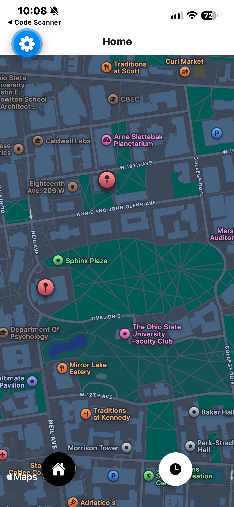
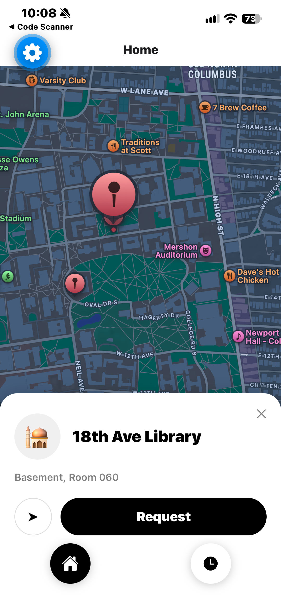

# SaffBuddy

Find others on campus to pray in congregation with.

SaffBuddy is a mobile app for Ohio State students. It shows the campus prayer rooms on a map. Students can post a **request** to pray at a room at a chosen time, and others can join it, so nobody waits around or prays alone without knowing whether anyone is coming. *Saff* is the Arabic word for the row worshippers stand in during congregational prayer.

<p align="center">
  
  &nbsp;&nbsp;
  
</p>

> **Status:** in active development. Login, the campus map and room details work on iOS. Prayer requests are designed and being built next, with a TestFlight beta planned.

## Features

**Working now**
- Passwordless login: an email plus a 6-digit one-time code
- Accounts limited to `@osu.edu` emails, enforced by the database rather than by the app
- Campus map with a marker for each prayer room
- Room panel with floor, room number, description, and walking directions handed off to Apple Maps or Google Maps

**In progress**
- Profiles (first name and gender)
- Prayer requests: post, join, leave and cancel, with live updates and automatic expiry
- Push notifications (planned for after the beta)

## Privacy by design

- **No GPS tracking.** Prayer rooms are fixed places. Directions open your own maps app, so SaffBuddy never reads your location.
- **No history.** Requests are deleted when they expire or are cancelled.
- **Anonymous until you join.** Before joining, people see only the start time and how many have joined.
- **Rules live in the database.** OSU-only sign-up is already enforced there, and gender-separated visibility will be too, through Postgres row-level security. Because of this, a modified app can't get around them.
- **Anonymous metrics only.** Usage is counted per room per day, with no user IDs or times ([ADR 0001](docs/adr/0001-aggregate-congregation-counts.md)).

## Tech stack

| | |
|---|---|
| App | React Native 0.88, Expo SDK 58, TypeScript, Expo Router |
| Map | react-native-maps (Apple Maps on iOS, Google Maps on Android) |
| Backend | Supabase: Postgres, Auth, row-level security |
| Email | Resend (custom SMTP for login codes) |

## Project docs

- [GLOSSARY.md](GLOSSARY.md): the domain language (requests, joiners, rooms, etc.)
- [docs/adr/](docs/adr/): architecture decision records

## Running locally

You'll need Node.js, the Expo Go app on your phone, and a Supabase project.

1. Install dependencies:
   ```bash
   npm install
   ```
2. Create `.env.local` with your Supabase project's URL and publishable key:
   ```
   EXPO_PUBLIC_SUPABASE_URL=...
   EXPO_PUBLIC_SUPABASE_KEY=...
   ```
3. In the Supabase SQL editor, run [supabase/verify_osu_email.sql](supabase/verify_osu_email.sql). Then enable it as a "Before User Created" auth hook.
4. Start the dev server and scan the QR code with Expo Go:
   ```bash
   npx expo start
   ```
   If you're on a network that blocks device-to-laptop connections (such as campus Wi-Fi), use `npx expo start --tunnel`.
