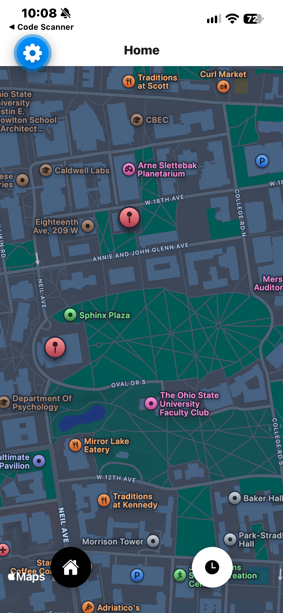
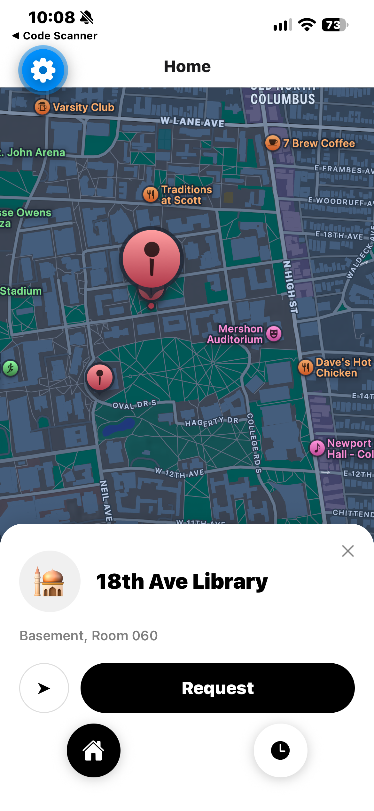

# SaffBuddy

Find others on campus to pray in congregation with.

SaffBuddy is a mobile app for Ohio State students. It shows the campus prayer rooms on a map. Students can post a **request** to pray at a room at a chosen time, and others can join it, so nobody waits around or prays alone without knowing whether anyone is coming. *Saff* is the Arabic word for the row worshippers stand in during congregational prayer.

<p align="center">
  
  &nbsp;&nbsp;
  
</p>

> **Status:** in active development on iOS. Sign-in, the campus map, prayer requests (post, join, leave, live updates and expiry), prayer times and account deletion all work. A TestFlight beta is next.

## Features

**Working now**
- Passwordless login: an email plus a 6-digit one-time code
- Accounts limited to `@osu.edu` emails, enforced by the database rather than by the app
- Campus map with a marker for each prayer room
- Room panel with floor, room number, description, and walking directions handed off to Apple Maps or Google Maps
- Profiles (first name and gender), and in-app account deletion
- Prayer requests: post, join, leave and cancel, with live updates and automatic expiry
- Prayer times for campus, with a countdown to the next prayer

**Planned**
- Push notifications (after the beta)

## Privacy by design

- **No GPS matching or tracking.** Prayer rooms are fixed places. If you allow location, the map shows where you are; the position stays in memory on your phone and is never sent or saved ([ADR 0002](docs/adr/0002-on-device-location-only.md)).
- **No history.** Requests are deleted when they expire or are cancelled.
- **Anonymous until you join.** Before joining, people see only the start time and how many have joined.
- **Rules live in the database.** OSU-only accounts and gender-separated visibility are enforced by Postgres row-level security, grants and triggers, with tests for each rule (`npm test`). Because of this, a modified app can't get around them.
- **Anonymous metrics only.** Usage is counted per room per day, with no user IDs or times ([ADR 0001](docs/adr/0001-aggregate-congregation-counts.md)).

## Tech stack

| | |
|---|---|
| App | React Native 0.88, Expo SDK 58, TypeScript, Expo Router |
| Map | react-native-maps (Apple Maps on iOS, Google Maps on Android) |
| Backend | Supabase: Postgres, Auth, row-level security |
| Email | Resend (custom SMTP for login codes) |

## Project docs

- [GLOSSARY.md](GLOSSARY.md): the domain language (requests, joiners, rooms, etc.)
- [docs/adr/](docs/adr/): architecture decision records

## Running locally

You'll need Node.js, the Expo Go app on your phone, and a Supabase project.

1. Install dependencies:
   ```bash
   npm install
   ```
2. Create `.env.local` with your Supabase project's URL and publishable key:
   ```
   EXPO_PUBLIC_SUPABASE_URL=...
   EXPO_PUBLIC_SUPABASE_KEY=...
   ```
3. In the Supabase SQL editor, run the files in [supabase/](supabase/) in this order (each uses tables or functions from the ones before it): `profile.sql`, `rooms.sql`, `requests.sql`, `joins.sql`, `tally.sql`, `expiry.sql`, `live_updates.sql`, `delete_account.sql`, `verify_osu_email.sql`. Then enable `verify_osu_email` as a "Before User Created" auth hook. The `hardening_*.sql` files are one-time migrations for a database set up before them; a fresh project doesn't need them.
   `npm test` runs the checks in [supabase/tests/](supabase/tests/) on a local Postgres. Run them in the SQL editor too, to check the live project.
4. Start the dev server and scan the QR code with Expo Go:
   ```bash
   npx expo start
   ```
   If you're on a network that blocks device-to-laptop connections (such as campus Wi-Fi), use `npx expo start --tunnel`.
